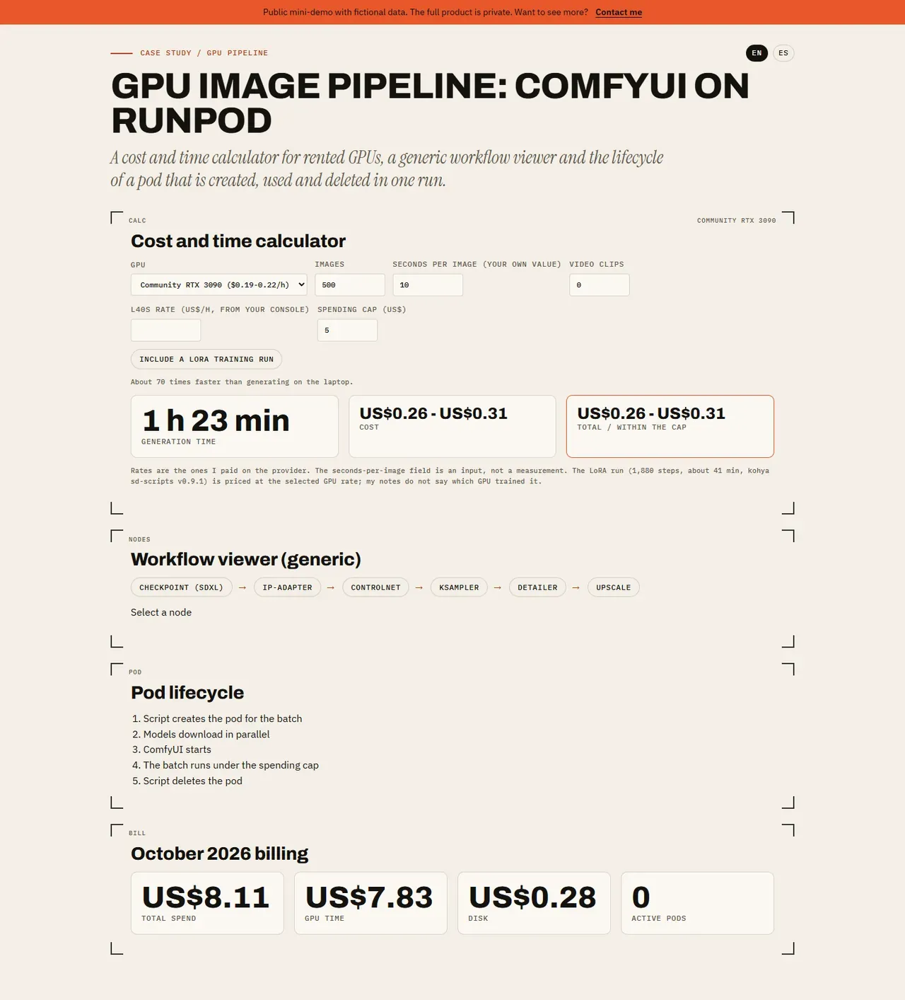

# GPU image pipeline — ComfyUI on Runpod

## Screenshots



> Public mini-demo with fictional data. The full product is private; access on request: carrerabernal@gmail.com

## Live demo

https://carrerable.github.io/gpu-image-pipeline-demo/

## What it demonstrates

- A cost and time calculator for rented GPUs: images x seconds per image / 3,600 x US$ per hour, plus an optional LoRA training run, video clips and a spending cap.
- A generic workflow viewer: SDXL checkpoint, IP-Adapter, ControlNet, KSampler, detailer, upscale.
- The lifecycle of a pod that is created for one batch and always deleted afterwards, and the real October 2026 billing figures (US$8.11 total, no pods left running).
- `scripts/runpod_setup.example.sh`: an illustrative script, written from scratch, that refuses to start above a spending cap and deletes the pod on exit. It reads `RUNPOD_API_KEY` from the environment and contains no key.

## What is fictional and what is real

The number of images and the seconds per image are inputs you type, not measurements. These figures are real, from my own notes: Community RTX 3090 about US$0.19-0.22/h (about 70 times faster than my laptop); Secure RTX 4090 US$0.89/h; image-to-video with Wan 2.2 on an L40S, about 24 minutes per clip at 20 steps; a 1,880-step LoRA training with kohya sd-scripts v0.9.1 in about 41 minutes; October 2026 spend US$8.11. The L40S hourly rate is not in my notes, so you enter it. There are no generated images in this demo.

## Run locally

```bash
npm ci && npm run dev
```

Add `?lang=es` for Spanish.

## Tests

```bash
npm test
```

## How it was built

Code written with Claude Code under my specs and code review; I designed the behavior, wrote the acceptance tests and verified the result.

## Case study

https://carrerable.github.io/en/projects/gpu-image-pipeline/

## License

MIT
